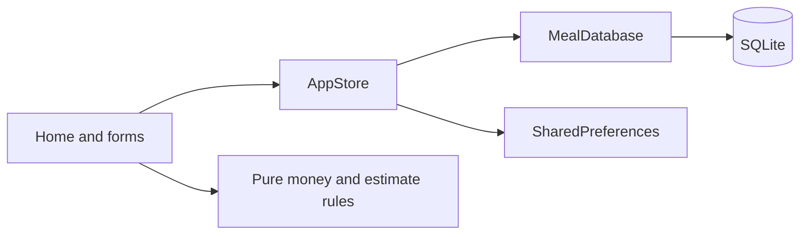

# Budget Bites architecture

## Ownership and dependency direction

`main.dart` owns AppStore and the database lifetime. Screens observe AppStore, own form drafts and call the data boundary. MealDatabase owns SQLite connections, constraints, migration and CRUD. SharedPreferences stores budget and dark mode. Domain helpers contain pure Dart money parsing and Lunch Lens rules, with no Flutter or database dependencies.

AppStore is a small ChangeNotifier; forms use StatefulWidget for drafts and saving status. Stateless MealCard and EmptyView render passed values. A full state framework is unnecessary for undergraduate scope. Constructor injection and an overridable database boundary allow widget tests to use a fake; real plugin behavior is tested on Android. A repository interface would improve larger-scale substitution but adds little here.

## Two related entities

- `meals`: SQLite-generated id, name, venue note, cuisine, entree/side/other labels and integer-cent amounts, favorite flag. Total is derived from the three amounts.
- `purchase_logs`: generated id, mealId foreign key, UTC epoch milliseconds, actualPriceMinor, note and unique saveToken.

Foreign keys are enabled on connection. Parent deletion is restricted while receipts exist. The UI reports the linked count, and SQLite remains the final consistency guard. Child deletion requires confirmation and refreshes all derived views. Favorites is a Meal flag, not a third entity. Historical actual amounts never change when a parent estimate is edited.

SQL uses bound arguments. Money input accepts decimal digits up to two places and parses into integer cents. Checks reject invalid monetary values. Version 2 migrates the teammate's version-1 REAL dollar prices to integer cents without changing row IDs. An actual old-schema fixture is tested on device. Fresh installs bundle two explicitly fictional meals and no purchase history.

## Saving and lifecycle

Purchase drafts carry a stable unique token; repeated saves return the same existing receipt. A deliberate new purchase receives a new token. The Save button is disabled during the database write, and a failed write retains the draft. Confirmed reset clears only the active draft. Form drafts are transient; saved receipts and preferences survive restart. Historical active-draft restoration is not promised.

Screens dispose TextEditingControllers. AppStore suppresses notifications after disposal; UI callbacks check mounted after asynchronous gaps. The app owner closes the connection on disposal. No timers or network requests are used. Derived totals and estimates are recomputed from current rows after mutations.

## Trade-offs and limitations

All data is device-local and is not synchronized or backed up by this app. Prices/venues are user-entered or fictional, not live verified information. Date filtering uses the device's local calendar day; timestamps store epoch milliseconds. Both tested emulators currently use Android API 37, so OS-version diversity is limited. Release mode currently uses the coursework scaffold's debug signing certificate; it is installable for coursework, not prepared for Play Store publication.
